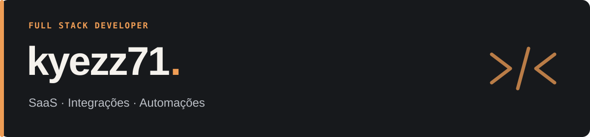

  

**Desenvolvimento full stack com foco em SaaS, CRMs e automações.**

Trabalho com aplicações web, painéis de operação e integrações entre serviços. Conecto interfaces, regras de negócio e dados para construir ferramentas úteis no dia a dia.

### O que eu construo

- **SaaS e plataformas web:** aplicações com autenticação, gestão de dados e fluxos de negócio.
- **CRMs e painéis:** ferramentas para acompanhar leads, organizar processos e visualizar a operação.
- **Integrações e automações:** APIs, webhooks e comunicação entre sistemas.
- **E-commerce:** interfaces de lojas e personalização de temas Shopify.

### Stack

| Área | Tecnologias |
| --- | --- |
| Linguagens | TypeScript · JavaScript |
| Frontend | React · Next.js · Tailwind CSS |
| Backend e dados | Node.js · PostgreSQL · Supabase · Drizzle ORM |
| E-commerce | Shopify · Liquid |
| Ferramentas | Git · GitHub · Vercel · Playwright |

### Como eu penso software

Prefiro soluções simples de manter, interfaces que deixam o próximo passo claro e integrações verificadas de ponta a ponta. Busco entender a regra de negócio antes de escolher a implementação.

---

Os projetos comerciais deste perfil estão em repositórios privados.
